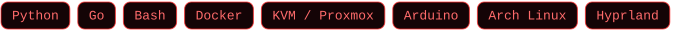

ZLEE12 · LIVE

✦ ───────────────────────────── ✦

## Who I am

Prototyping anything I need — from mouse firmware to a ClockworkPi uConsole radio rig, built to use, not to show.

**Focus**

> *"It's not your right to decide whether they live or die. They deserve a chance."* — Vash the Stampede
>
> *"Do nothing which is of no use."* — Miyamoto Musashi, Dokkōdō

✦ ───────────────────────────── ✦

## The stack

Chosen for the work, not the trend.

✦ ───────────────────────────── ✦

## Built, shipped, shared

**[m913ctl](https://github.com/Zlee12/m913ctl)** — Configure a Redragon M913 mouse on Linux: buttons, macros, DPI and lighting, written straight to onboard memory. CLI, TUI and a GTK4 app over one config. Built because the vendor only ships Windows.

**Not everything is public** — Security &amp; systems tooling, trading tools, multi-agent experiments: kept private for opsec. Public releases land here.

✦ ───────────────────────────── ✦

## The trail behind the work

<em>"The quieter you become, the more you are able to hear."</em> — Ram Dass

✦ ───────────────────────────── ✦

LOVE &amp; PEACE — WITH A THREAT MODEL

### Let's build something that lasts.

<em>"I wanted to save them both."</em> — Vash the Stampede

<a href="https://github.com/Zlee12"><b>GitHub</b></a> · <a href="https://buymeacoffee.com/zlee12"><b>Buy Me a Coffee</b></a>

