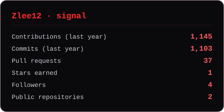
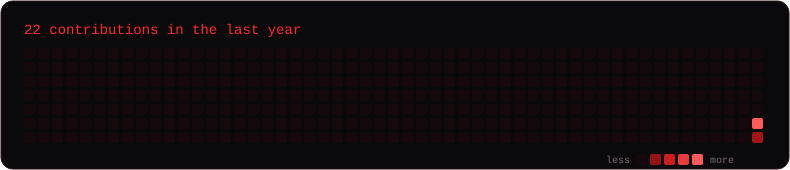

ZLEE12 · LIVE

### Threat Hunter · AI Red Team · Systems &amp; Security Engineer

Security · Microcontrollers · DIY &amp; hardware hacking

<a href="https://github.com/Zlee12"><b>GitHub</b></a> · <a href="https://buymeacoffee.com/zlee12"><b>Buy Me a Coffee</b></a>

✦ ───────────────────────────── ✦

## Who I am

Threat hunting · AI red-teaming · hardware I can hold — prototyping anything from mouse firmware to a ClockworkPi uConsole radio rig.

**Focus** — `offense to defend` · `build-in-the-open` · `local-first`

> *"It's not your right to decide whether they live or die. They deserve a chance."* — Vash the Stampede
>
> *"Do nothing which is of no use."* — Miyamoto Musashi, Dokkōdō

✦ ───────────────────────────── ✦

## What moves the work

<code>threat hunting</code> — finding what hides in the noise 
<code>AI red-team</code> — adversarial LLM security 
<code>hardware</code> — prototyping, firmware, PCBs, rigs

Less talk, more proof.

✦ ───────────────────────────── ✦

## The stack

<code>Python</code> · <code>Go</code> · <code>Bash</code> · <code>Docker</code> · <code>KVM / Proxmox</code> · <code>Arduino</code> · <code>Arch Linux</code> · <code>Hyprland</code>

Chosen for the work, not the trend.

✦ ───────────────────────────── ✦

## Built, shipped, shared

**[m913ctl](https://github.com/Zlee12/m913ctl)** — Configure a Redragon M913 mouse on Linux: buttons, macros, DPI and lighting, written straight to onboard memory. CLI, TUI and a GTK4 app over one config. Built because the vendor only ships Windows.

`Python` · `GTK4` · `HID`

**Not everything is public** — Security &amp; systems tooling, trading tools, multi-agent experiments: local-first, kept private for opsec. Public releases land here.

✦ ───────────────────────────── ✦

## Momentum, made visible

✦ ───────────────────────────── ✦

## The trail behind the work

<em>"The quieter you become, the more you are able to hear."</em> — Ram Dass

✦ ───────────────────────────── ✦

LOVE &amp; PEACE — WITH A THREAT MODEL

### Protect what lives.

<em>"I wanted to save them both."</em> — Vash the Stampede

<a href="https://github.com/Zlee12"><b>GitHub</b></a> · <a href="https://buymeacoffee.com/zlee12"><b>Buy Me a Coffee</b></a>

